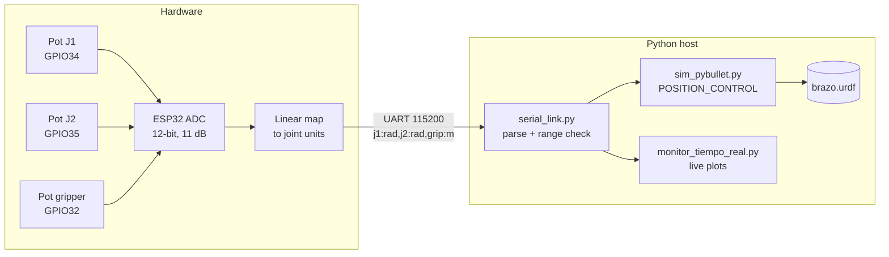

# ESP32 Robotic Arm → PyBullet Digital Twin

Real-time teleoperation of a simulated robotic arm: three potentiometers wired to an **ESP32** set the joint angles of an **URDF** arm running in **PyBullet**. The ESP32 streams the joint commands over UART at 20 Hz, and a Python host parses them, validates them and drives the simulation.

> Course project, Microcontrollers, B.Sc. Mechatronics Engineering, Universidad Militar Nueva Granada (Colombia).


## Architecture



| Joint | Input | Firmware range | URDF joint | Notes |
|---|---|---|---|---|
| Base rotation | GPIO34 | −2.5 … 2.5 rad | `joint_1` (revolute, Z) | |
| Shoulder | GPIO35 | −2.0 … 2.0 rad | `joint_2` (revolute, Y) | clamped to ±1.57 rad, the URDF limit |
| Gripper | GPIO32 | 0 … 0.05 m | `joint_dedo_izq/der` (prismatic) | scaled to the 0–20 mm finger stroke |

### Serial protocol

One ASCII line per sample, every 50 ms:

```
j1:0.512,j2:-1.204,grip:0.031
```

The host rejects incomplete lines (e.g. when the port opens mid-line), corrupted numbers and out-of-range values, so the robot never jumps to a garbage pose. `tests/test_serial_link.py` covers these cases.

## Repository layout

```
firmware/brazo_esp32/brazo_esp32.ino   ESP32: read pots, map, stream over UART
urdf/brazo.urdf                        3-DOF arm + 2-finger prismatic gripper
python/serial_link.py                  serial connection + robust line parser
python/sim_pybullet.py                 PyBullet digital twin (or --demo without hardware)
python/monitor_tiempo_real.py          live matplotlib plots of the 3 commands
python/control_brazo.py                terminal status console
python/latency_check.py                measures sample rate / inter-sample time
tests/                                 parser unit tests (pytest)
```

## How to run

```bash
pip install -r requirements.txt

# 1. Flash firmware/brazo_esp32 with Arduino IDE (board: ESP32 Dev Module)
# 2. Check the link (expects ~20 samples/s)
python python/latency_check.py
# 3. Run the digital twin
python python/sim_pybullet.py --port COM3
#    ...or without hardware
python python/sim_pybullet.py --demo
# 4. Tests
python -m pytest
```

## Hardware

ESP32 DevKit V1 · 3 × 10 kΩ potentiometers (wiper to GPIO34/35/32, ends to 3.3 V and GND) · breadboard · USB cable.

## What I learned

- ADC configuration on the ESP32 (12-bit, 11 dB attenuation to cover 0–3.3 V) and mapping raw counts to physical units.
- Designing a simple, self-describing serial protocol and validating it on the host side.
- Building a URDF model (links, revolute and prismatic joints, limits) and controlling it in PyBullet.
- Keeping firmware and host in sync: an earlier version of the host scripts expected a different message format than the firmware sent, so the parser now lives in one module with unit tests.

## Next steps

- Use the 4th DOF (`joint_gripper`, wrist) with an extra potentiometer.
- Close the loop with real servos and compare the simulated and real poses.

---

<details>
<summary><b>🇪🇸 Versión en español</b></summary>

## Brazo robótico con ESP32 y gemelo digital en PyBullet

Teleoperación en tiempo real de un brazo robótico simulado. Tres potenciómetros conectados a un **ESP32** fijan los ángulos de las articulaciones de un brazo **URDF** que corre en **PyBullet**. El ESP32 envía los comandos por UART a 20 Hz, y un programa en Python los recibe, los valida y mueve la simulación.

> Proyecto de la asignatura Microcontroladores, Ingeniería Mecatrónica, Universidad Militar Nueva Granada.

**Funcionamiento**
1. **ESP32:** lee los potenciómetros con el ADC de 12 bits (atenuación de 11 dB) y los convierte en ángulos en radianes y en la apertura de la pinza en metros.
2. **Protocolo:** envía una línea por muestra con el formato `j1:<rad>,j2:<rad>,grip:<m>`.
3. **Python:** `serial_link.py` descarta las líneas incompletas, corruptas o fuera de rango. `sim_pybullet.py` mueve las articulaciones del URDF con control de posición. `monitor_tiempo_real.py` grafica las señales en vivo.

**Uso:** `pip install -r requirements.txt` y luego `python python/sim_pybullet.py --port COM3`. Si no tienes el ESP32 conectado, usa `--demo`.

**Aprendizajes:** configurar el ADC del ESP32, diseñar y validar un protocolo serial, modelar un robot en URDF y simularlo en PyBullet, y mantener sincronizados el firmware y el programa del PC con pruebas unitarias.

</details>
